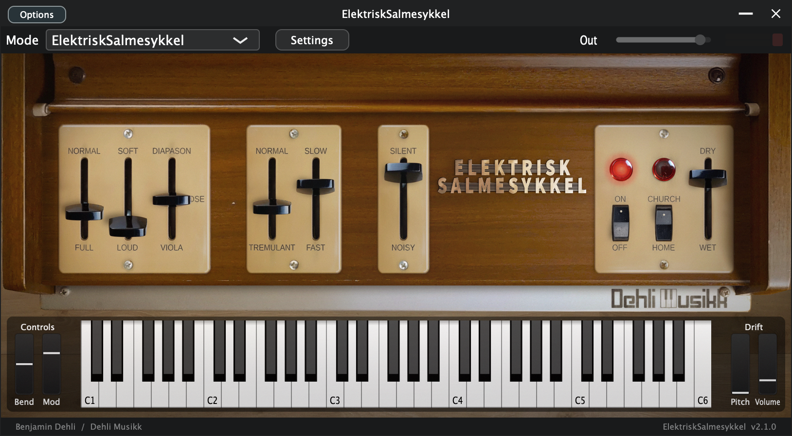
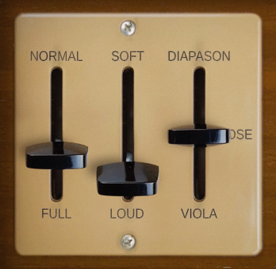
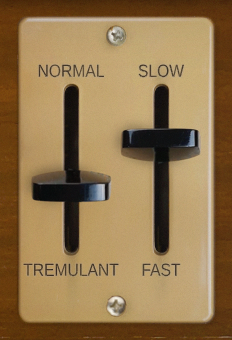
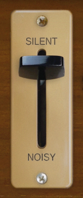
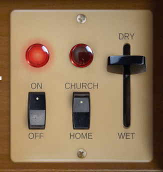
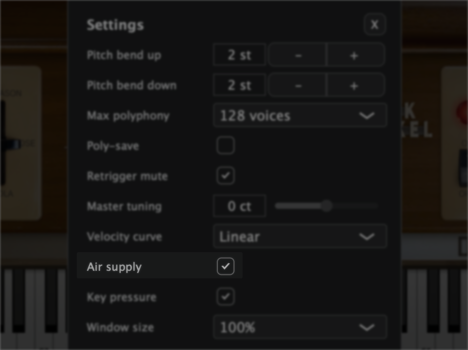

# Elektrisk Salmesykkel

**[Product page and documentation](https://benjamindehli.github.io/ElektriskSalmesykkel/)**

A Yamaha L-20D electric harmonium / reed organ with some added features

## Release notes

### Version 2.2.0 (2026-11-25)

The changes in this release apply to the plugin version only. The DecentSampler version is unchanged.

- The plugin is now also available for Windows and Linux, as VST3 and Standalone. These versions have not yet been tested on Windows and Linux computers.
- The window can be resized from its own size to twice that, by dragging its bottom-right corner or with the new window size setting in the settings menu. The size is saved with the project.
- Added Undo and Redo buttons. Knob moves, button presses and menu choices can be undone, also with Cmd+Z and Shift+Cmd+Z (Ctrl+Z and Shift+Ctrl+Z on Windows and Linux). Automation is not recorded as steps.
- Added key pressure for MPE controllers, with per-note pitch bend. See the section "Key pressure".
- Every control has a name for screen readers such as VoiceOver, and a screen reader goes through the window in a sensible order.
- The buttons and menus have names in the DAW's automation list instead of numbers. Existing automation of them keeps working.
- If the samples cannot be found, the plugin now says so and where they should be, instead of playing silence.
- The plugin tells the DAW how long its reverb and release tails last, so they are not cut off at the end of an export.
- An optional check for new versions. The first time the plugin opens, it asks whether it may check. It reads one small file from the product page and sends nothing about you. A new version is shown in the bottom strip.
- A damaged value in a saved project or preset is set back to its default instead of reaching the sound.
- Built on JUCE 9.0.6.

### Version 2.1.0 (2026-08-01)

The changes in this release apply to the plugin version only. The DecentSampler version is unchanged.

- Added a translucent overlay graphic on top of the interface.
- Keys that are hovered or held on the keyboard are now shaded in a neutral way instead of turning yellow:
  - White keys turn darker.
  - Black keys turn brighter.
- The computer keyboard keeps playing notes even while you adjust a control with the mouse.

### Version 2.0.0 (2026-07-19)

- Added a plugin version. See the section "The plugin version".
- Added an air supply emulation to the plugin version. See the section "Air supply".
- Standardized the UI values for the controllers.
- Fixed the default value for the tremulant depth.
- The indicator lights now use the off image as default, matching the default state.

### Version 1.2.0 (2025-01-04)

- Removed amplitude envelope for one shot samples

### Version 1.1.0 (2024-02-15)

- Improved crossfades for loop points

### Version 1.0.0 (2024-02-11)

- First version released

## Included formats

- VST3 (macOS, Windows and Linux)
- AU (macOS)
- Standalone application (macOS, Windows and Linux)
- Decent Sampler (macOS, Windows and Linux)

The Windows and Linux versions of the plugin are new and have not yet been tested on those systems.

## The plugin version

The plugin is a self-contained instrument, available as VST3, AU and Standalone.
The graphics are embedded in the plugin, and the samples and impulse responses come in one losslessly compressed file that the installer puts in place, so there is nothing to locate by hand.
Only the samples for the selected preset are loaded into memory, and a fresh instance lets you choose which preset to load before anything is decoded.

The plugin has all the controls and features from the Decent Sampler version, including MIDI learn, the master volume fader with output meter, value readouts for the knobs and full DAW automation.
On top of that, the plugin version adds:

- Drift wheels next to the pitch and modulation wheels, adding a subtle random pitch and volume drift to each voice.
- A velocity curve setting in the settings menu.
- An emulation of the shared air supply. See the section "Air supply".
- A resizable window, from its own size to twice that.
- Undo and Redo.
- Key pressure for MPE controllers. See the section "Key pressure".

## The Decent Sampler version

This version of Elektrisk Salmesykkel is an instrument preset / sample library for Decent Sampler. If you're new to Decent Sampler, I recommend checking out [this guide][Decent Sampler guide] first.

## Technical specification

|                       | Sample rate | Bit depth | Channels   | Number of files | File size  |
|----------------------:|------------:|----------:|------------|----------------:|-----------:|
|  **Samples (Reeds)**  |      48 kHz |    24 bit | 2 (stereo) |             183 |  855.60 MB |
|  **Samples (Noise)**  |      48 kHz |    24 bit | 2 (stereo) |             366 |   63.60 MB |
| **Impulse responses** |      48 kHz |    24 bit | 2 (stereo) |               2 |    2.50 MB |

## Instrument presets

This instrument includes 2 presets, the regular preset "ElektriskSalmesykkel" (best in most cases) and the looped preset "ElektriskSalmesykkel (Looped)". For the regular version, each sample are approximately 16 seconds long. For the looped version, to achieve the best possible loop point, some of the loops are short and some are longer. Some of the loops will however have some minor artifacts. For best audio quality, you should always use the regular version. And only if you have notes held for more than 16 seconds, use the the looped version.

## User Interface

||
|:--:|
|Overview|

Controls are grouped by what they act on: the wind supply, the reeds, the tremulant, mechanical noise and reverb.

### Wind and reed settings

||
|:--:|
|Wind and reed controls|

- Normal / Full (Swell)
  - Controlled by a knee lever on the original instrument and with the modulation wheel in the plugin
  - Gradually open up the swell chambers
- Soft / Loud (Loudness)
  - Determines how much air flows through the reeds
- Diapason / Close / Viola
  - Diapason: Permanently opens the swell chamber for the diapason reeds
  - Close: Both swell chambers is closed
  - Viola: Permanently opens the swell chamber for the viola reeds

### Tremulant

||
|:--:|
|Controls for the tremulant settings|

Tremulant varies the wind supply to the reeds. The controls enable you to adjust the tremulant with the desired depth and rate.

- Normal / Tremulant (Depth)
  - Adjust the depth to introduce subtle or pronounced tremulant effect
- Slow / Fast (Rate)
  - Determines the speed of the tremulant effect

### Noise

||
|:--:|
|Noise controls|

- Silent / Noisy
  - The amount of mechanical noise from the keys when pressed down and released

### Reverb

||
|:--:|
|Controls for the room reverb impulse response|

Both reverbs are impulse responses of a Chase Bliss Audio & Meris CXM 1978 pedal: a short one for a small room (home) and a long one for a church.

- On / Off
  - Turns the reverb on and off
- Church / Home
  - Switches between a long/big room (church) reverb and a short/small room (home) reverb
- Dry / Wet
  - Mix between direct signal (dry) and reverb signal (wet)

## Air supply (plugin version only)

||
|:--:|
|Toggle for air supply emulation in the settings menu|

The original Yamaha L-20D has a motor driven fan that supplies air to all the reeds.
When many notes are played at once, each reed gets a smaller share of the air.
The plugin emulates this behavior: the more notes you hold, the lower the volume, the softer the top end and the slower the attack of each note.
The air recovers quickly when notes are released, just like the real blower.
The emulation only affects the reed samples, not the mechanical key noises, and it can be turned on or off in the settings menu.

## Key pressure (plugin version only)

On the original instrument, each key opens a valve that lets air through to its reeds.
A key that is only partly pressed lets less air through, so the reed sounds softer, darker and slightly flat, and below a certain point it does not sound at all.
The plugin emulates this with an MPE controller: the pressure on each key sets how much air its reeds get.
As on the real instrument, most of the change happens at the very start of the key press.
The curves are based on recordings of the real instrument with a key pressed down very slowly.

- MPE controllers also get per-note pitch bend.
- Keyboards without MPE play every note with full air, exactly as the samples were recorded.
- The mechanical key noises are not affected.
- When air supply is on, a partly pressed key also draws less air from the blower.
- Key pressure can be turned on or off in the settings menu.

## About this repository

This repository contains the source for both the Decent Sampler library (the DecentSampler folder) and the plugin version.
The plugin is a thin wrapper around the shared Dehli Musikk sampler engine, and a converter translates the Decent Sampler library into the engine's native preset format at build time.
The audio files are not part of this repository, since the samples are a paid product.
The full version is available from [store.dehlimusikk.no][Gumroad profile].

[Gumroad profile]: https://store.dehlimusikk.no/
[Decent Sampler guide]: https://www.decentsamples.com/how-to-use-decent-sampler/
